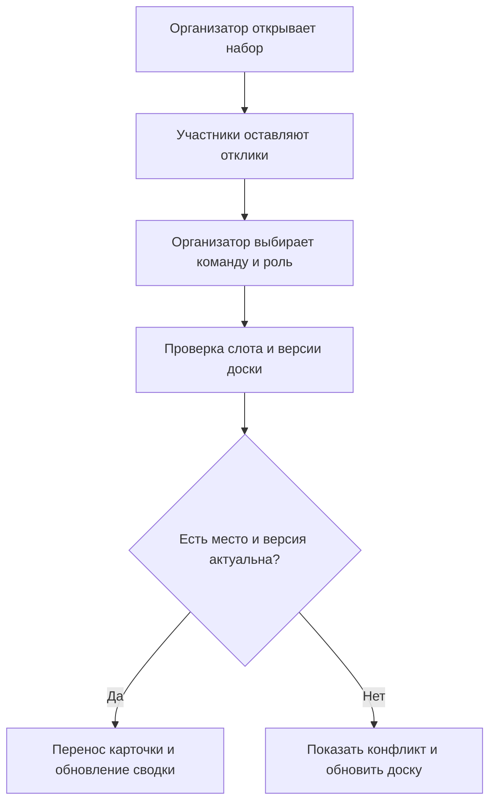

# 205 · Доска сборки команд

Репозиторий `team-assembly-board` · приложение с сервером

**Продукт и интерфейс.** Организатор открывает набор и задаёт необходимые роли. Участник подаёт карточку с именем, навыками, интересами и желаемыми ролями. На доске организатор видит очередь кандидатов и колонки команд, перетаскивает карточки или назначает через меню. Сводка показывает незакрытые роли. Участник видит итог своего назначения.

**Архитектура и данные.** React, FastAPI, SQLite. Модель включает набор, профиль, отклик, команду, слот роли и назначение. Сервер соблюдает вместимость слотов, уникальность назначения участника внутри набора и права организатора. Фильтр навыков помогает найти карточки по тегам. Решение о составе принимает организатор, ML не требуется.

**Блок-схема основного сценария**



**Функциональные правила.** Слот роли задаёт вместимость, назначение связывает отклик со слотом. Перенос освобождает старое место и занимает новое в одной транзакции. Заполнение считается по слотам, а карточку без назначения можно вернуть в очередь.

**Контракты реализации.** API `GET /recruitments/{id}/board`, `POST /recruitments/{id}/applications`, `PUT /applications/{id}/assignment` и `DELETE /applications/{id}/assignment`. При записи передавать версию назначения. При конфликте вернуть актуальную доску или запросить её повторно.

**Проверки граничных случаев.** Проверить заполненный слот, перемещение внутри одной команды и параллельное назначение. Участник может видеть своё назначение, менять состав может организатор.

**Псевдокод ядра**

```text
начать транзакцию записи
проверить роль организатора и открытый набор
прочитать текущее назначение и проверить версию
проверить, что новый слот принадлежит набору
посчитать занятость нового слота без текущего отклика
если слот заполнен, отменить транзакцию и вернуть конфликт
обновить назначение, увеличить версию и зафиксировать транзакцию
вернуть сохранённое назначение и число свободных мест
```

**Разработка и приёмка.** Реализовать набор, отклики и роли, затем доску и API назначений, после — сводку и экспорт состава. На демо с восемью кандидатами собрать две команды, оставить одну роль открытой, перенести участника и убедиться, что повторное назначение того же человека запрещено.

**Проверки ночного пилота по пяти раундам**

1. Сверить роли, заполненность слотов, перенос и освобождение прежнего места.
2. Запустить конкурирующие запросы на один слот, затем перезапустить контейнер и проверить сохранение состава.
3. Собрать команду с клавиатуры через меню и проверить восстановление доски после конфликта.
4. Замерить загрузку доски и назначение на наборе из 100 синтетических откликов, диагностировать самый медленный шаг.
5. Из распакованного ZIP поднять контейнер, загрузить демоданные, войти обеими ролями и повторить назначение.
